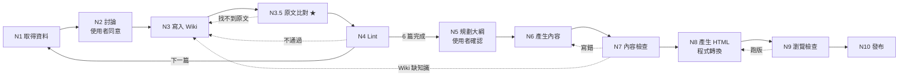

# LLM Wiki 教學簡報：Transformer 論文與其應用變化

> 🌐 **網站首頁**：https://midtwo945.github.io/TAICA_AI_2026_HW10/ ｜ 📊 **教學簡報**：https://midtwo945.github.io/TAICA_AI_2026_HW10/slides/

## 1. 主題與簡介

**主題：Transformer 論文與其應用變化**

以 6 篇關鍵論文建立 LLM Wiki，說明 attention 如何從 RNN 翻譯模型的輔助機制，變成 Transformer 的核心，再分化成 BERT、GPT-3、T5、ViT 等不同的應用變化。

| # | 論文 | 在主題中的角色 |
|---|---|---|
| 1 | Bahdanau et al. 2014, *Neural Machine Translation by Jointly Learning to Align and Translate* | 前傳：attention 誕生 |
| 2 | Vaswani et al. 2017, *Attention Is All You Need* | 主角：Transformer |
| 3 | Devlin et al. 2018, *BERT* | 變化：只用 Encoder |
| 4 | Brown et al. 2020, *Language Models are Few-Shot Learners*（GPT-3） | 變化：只用 Decoder、放大規模 |
| 5 | Raffel et al. 2019, *T5* | 變化：Encoder-Decoder、text-to-text；架構家族的比較 |
| 6 | Dosovitskiy et al. 2020, *An Image is Worth 16x16 Words*（ViT） | 變化：從文字跨到圖片 |

## 2. LLM Wiki

- **Wiki 目錄**：[wiki/index.md](wiki/index.md)，共 28 頁：論文頁 6、概念頁 17、模型頁 5
- **規則（Schema）**：[CLAUDE.md](CLAUDE.md)，R1～R20
- **原始資料**：6 篇論文皆來自 arXiv（連結見 [raw/README.md](raw/README.md)）。因著作權考量，PDF 與全文不上傳；執行 `bash scripts/fetch_raw.sh` 可重新下載並轉成文字檔
- 每個段落都標註出處（論文章節）；每篇論文的原文比對紀錄在 [wiki/checks/](wiki/checks/)

## 3. 教學 HTML 簡報

- **線上瀏覽**：https://midtwo945.github.io/TAICA_AI_2026_HW10/slides/
- 原始檔：[slides/index.html](slides/index.html)，共 18 頁，可用 ← → 或空白鍵翻頁，手機可滑動翻頁
- 每頁底部列出內容來源的 Wiki 頁面（可點擊）；第 8 頁有遮罩切換的互動 demo
- 大綱：[slides/outline.md](slides/outline.md)；內容：[slides/content.md](slides/content.md)

## 4. Loop / Graph 設計

完整說明：[docs/workflow.md](docs/workflow.md)



- **重複執行**：N1～N4 每篇論文一次（共 6 次）；各檢查點不通過時退回修正
- **檢查點**：N2、N5 由使用者確認；N3.5、N7 逐段比對；N4、N5、N7、N9 有自動檢查程式（[scripts/](scripts/)）
- **設計理由**：簡報只能引用 Wiki、Wiki 只能引用原文，形成「簡報 → Wiki → 原文」的追溯鏈；能用程式檢查的就用程式

## 5. 實際執行與檢查紀錄

- **完整執行紀錄**：[wiki/log.md](wiki/log.md)，每個節點每次執行的結果與原因
- **原文比對紀錄（N3.5）**：[wiki/checks/](wiki/checks/)，每篇論文逐段對照原文句子
- **簡報內容檢查紀錄（N7）**：[wiki/checks/slides.md](wiki/checks/slides.md)

| 節點 | 結果 |
|---|---|
| N3.5 原文比對 | 論文 3～6 共抓到 18 個內容錯誤（3、8、1、6），全部修正 |
| N4 Lint | 7 次執行，1 次不通過（缺出處），重試後通過 |
| N7 內容檢查 | 第 1 次不通過：術語沒解釋 21 個、來源不符 1 個、Wiki 缺知識 1 個（回 N3 補寫）；第 2 次通過 |
| N9 瀏覽檢查 | 第 1 次不通過：1 頁超出畫面、鍵盤翻頁程式出錯；修正後 5 種螢幕尺寸全部通過 |

## 6. 反思

完整內容：[docs/reflection.md](docs/reflection.md)

- **最常出錯的節點：N3 寫入 Wiki。** 22 個內容錯誤源自這裡：AI 用自己的知識補充、加原文沒有的白話解釋、把別篇論文的用語套進來、出處章節標錯、改寫時意思跑掉。這些錯誤格式都正確，所以 lint 全部會放過。
- **檢查往前移到哪裡：** 從 N4 格式 lint（以及「讀下一篇論文時才偶然發現」），往前移到緊接在 N3 之後的新節點 **N3.5 原文比對**，讓錯誤在寫入的同一輪就被修正，不會擴散到其他頁面。
- **對 workflow 的修改：** 新增 N3.5 與 R20；N5、N7 加上檢查程式；N8 改成程式轉換（不讓 AI 重寫，確保「檢查過的內容 = 顯示的內容」）；修正檢查程式本身的 bug。

## 資料夾結構

```
├── CLAUDE.md          Wiki 規則（R1～R20）
├── raw/               原始論文（不上傳，見 raw/README.md）
├── wiki/
│   ├── index.md       目錄
│   ├── log.md         執行紀錄
│   ├── papers/        論文頁（6）
│   ├── concepts/      概念頁（17）
│   ├── models/        模型頁（5）
│   └── checks/        原文比對與簡報檢查紀錄
├── slides/            大綱、內容、HTML 簡報
├── scripts/           lint、大綱檢查、簡報檢查、簡報產生程式
└── docs/              graph 說明、反思
```
