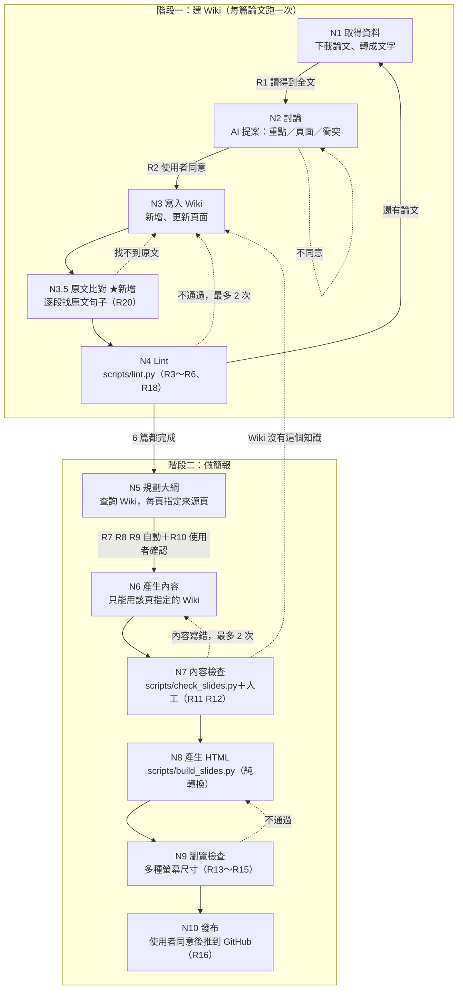

# Loop / Graph 設計說明

本作業用一個由使用者設計規則、AI 執行的 graph 來完成「建 Wiki → 做簡報」。
所有規則（R1～R20）寫在 [CLAUDE.md](../CLAUDE.md)，每次執行都記錄在 [wiki/log.md](../wiki/log.md)。

## 最終版 Graph

實線是正常流程；虛線是「檢查不通過時退回」的邊。

## 每個節點做什麼

| 節點 | 輸入 | 輸出 | 檢查 | 誰檢查 |
|---|---|---|---|---|
| N1 取得資料 | 論文清單 | `raw/*.pdf`、`raw/*.txt` | R1 讀得到全文 | AI＋程式 |
| N2 討論 | 原文 | 提案（重點、要新增或更新的頁面、衝突） | R2 同意才繼續 | **使用者** |
| N3 寫入 Wiki | 通過的提案 | `wiki/` 下的頁面 | — | — |
| N3.5 原文比對 | 新增或修改的段落 | `wiki/checks/*.md` 對照表 | R20 每段都能找到原文句子 | AI 人工 |
| N4 Lint | 整個 Wiki | 通過／不通過 | R3 出處、R4 連結、R5 孤兒頁、R18 頁首、R6 矛盾 | 程式＋AI |
| N5 規劃大綱 | `index.md` 與各頁 | `slides/outline.md` | R7 每頁有來源、R8 論文都用到、R9 先備在前、R10 確認 | 程式＋**使用者** |
| N6 產生內容 | 大綱、指定的 Wiki 頁 | `slides/content.md` | — | — |
| N7 內容檢查 | `content.md` | `wiki/checks/slides.md` | R11 論點在 Wiki 中、R12 術語有解釋 | 程式＋AI 人工 |
| N8 產生 HTML | `content.md` | `slides/index.html` | — | 程式（不經 AI） |
| N9 瀏覽檢查 | HTML | 通過／不通過 | R13 翻頁、R14 不超出畫面、R15 手機可看 | 瀏覽器＋程式 |
| N10 發布 | 全部檔案 | GitHub repo、GitHub Pages | R16 使用者同意 | **使用者** |

## 哪些步驟會重複執行？

1. **N1 → N4 的大迴圈**：每篇論文跑一次，共 6 次。每多一篇，AI 都要回頭更新舊頁面，所以 Wiki 是越長越完整，而不是只有 6 份獨立摘要。
2. **N3 ↔ N3.5、N3 ↔ N4 的修正迴圈**：比對或 lint 不通過就退回 N3。
3. **N2 ↔ N2 的討論迴圈**：使用者不同意就修改提案。
4. **N6 ↔ N7、N8 ↔ N9 的修正迴圈**：簡報內容或版面不通過就退回。
5. **N7 → N3 的跨階段迴圈**：簡報需要、但 Wiki 裡沒有的知識，必須先補進 Wiki（並經過原文比對和 lint），才能寫進簡報。

## 哪些地方需要檢查或重新生成？

| 檢查點 | 抓什麼錯 | 不通過時 |
|---|---|---|
| N2（人工） | AI 對論文的理解方向錯、頁面規劃不合理 | 重新提案 |
| N3.5（人工逐段） | 內容和原文不符：AI 自己補的知識、改寫失真、出處章節標錯、把別篇的用語套進來 | 回 N3 改寫 |
| N4（程式） | 格式：沒標出處、連結失效、孤兒頁、頁首缺欄位 | 回 N3，最多 2 次 |
| N5（程式＋人工） | 大綱某頁沒有來源、有論文沒用到、順序不對 | 修改大綱 |
| N7（程式＋人工） | 簡報的數字不在 Wiki、引用了清單外的頁面、術語沒解釋 | 回 N6；缺知識回 N3 |
| N9（瀏覽器） | 翻頁壞掉、文字超出畫面、手機跑版 | 回 N8 |

## 為什麼這樣設計？

1. **「先討論、後生成」放在 N2**：作業要求的核心。讓使用者在 AI 動手寫之前就能糾正方向，而且所有決定都留在 log 裡。
2. **Wiki 和簡報分成兩個階段，中間只靠 Wiki 連接**：簡報不能直接看論文，只能看 Wiki（R11）。這樣「簡報的每一句都能對回 Wiki」才有保證，而 Wiki 的每一句又能對回原文（R20），形成「簡報 → Wiki → 原文」的完整追溯鏈。
3. **N7 → N3 的邊**：如果簡報缺知識時允許 AI 直接寫進去，就等於繞過了 Wiki。強制先補 Wiki，Wiki 才是唯一的知識來源。
4. **能用程式檢查的就用程式**：格式（lint）、數字、連結、版面都交給程式，結果可重現；AI 和人力只用在程式判斷不了的「意思對不對」。
5. **N8 用程式轉換，不讓 AI 重寫**：N7 檢查的是 `content.md`。如果 N8 再讓 AI 寫一次 HTML，就可能冒出沒檢查過的文字。改成機械轉換後，「檢查過的內容 = 顯示的內容」。
6. **重試上限 2 次**：避免無限迴圈，超過就交給使用者判斷。

## 實際執行後對 Graph 的修改

| 修改 | 時機 | 原因 |
|---|---|---|
| **新增 N3.5 原文比對（R20）** | 論文 3 之前 | 論文 1、2 的 lint 全部一次通過，但 N3 已出現 5 個內容錯誤；其中 1 個到下一篇論文的 N2 才發現。lint 只檢查格式，抓不到內容錯誤 → 把內容檢查**往前移到緊接在 N3 之後** |
| N5、N7 加上檢查程式 | 階段二 | 大綱和簡報也有可以機械判斷的規則（來源存在、數字出現、術語解釋），不必全靠人工 |
| N8 改成純程式轉換 | 階段二 | 避免 N7 之後又出現新內容 |
| 修正 `check_slides.py` 的 bug | N7 第 1 次 | 程式要求術語「每次」出現都解釋，但 R12 只要求「第一次」 |

詳細的反思見 [reflection.md](reflection.md)。
